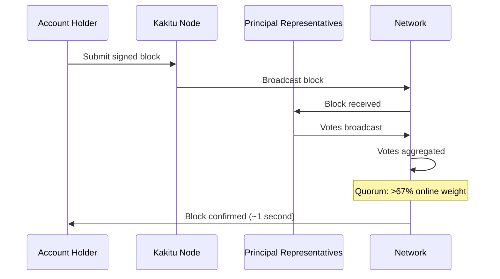

# Open Representative Voting (ORV)

Open Representative Voting (ORV) is Kakitu's consensus mechanism. It is a delegated voting system where account holders assign their balance weight to representatives, who then vote on the validity of transactions.

---

## Overview



---

## Key Concepts

### Voting Weight

Every `kshs_` address can hold delegated voting weight. When an account sets its representative, it delegates its entire balance to that representative's voting weight.

```
Representative X voting weight = sum of balances of all accounts
                                  that have delegated to X
```

Delegating does not move funds — you retain full custody of your KSHS. It only assigns your balance as voting weight to your chosen representative.

### Online Voting Weight

The network tracks **online voting weight** — the sum of weight held by representatives that have been recently active (sent votes within a rolling time window).

Quorum is calculated against online voting weight, not total supply. This ensures the network can confirm transactions even if a large portion of the supply is held in cold storage with no active representative.

### Quorum

A block is confirmed when representatives holding more than **67%** of the current online voting weight have voted for it.

```
quorum_delta = 0.67 × online_voting_weight
```

Once this threshold is crossed, the block is confirmed and cemented.

---

## Vote Messages

When a representative votes, it broadcasts a **vote message** to its peers:

```json
{
  "account": "kshs_REPRESENTATIVE",
  "signature": "VOTE_SIGNATURE",
  "sequence": "42",
  "blocks": [
    "A170D51B94E00371ACE76E35AC81DC9405D5D04D4CEBC399AEACE07AE05DD293"
  ]
}
```

- `sequence` is a monotonically increasing counter preventing vote replay attacks
- `blocks` is a list of block hashes this vote applies to

### Final Votes

A representative can emit a **final vote** with `sequence = 0xFFFFFFFFFFFFFFFF` to signal that their vote is definitive and they will not revote. Final votes accelerate confirmation by allowing nodes to stop waiting for additional vote messages.

---

## Principal Representatives

A **Principal Representative (PR)** holds at least **0.1% of online voting weight**. PR votes are rebroadcast by the nodes that receive them, propagating rapidly across the network.

Non-PR representative votes are not rebroadcast — they count toward quorum but don't propagate further.

The PR threshold means a small number of well-funded, reliable representatives carry the most influence on confirmation speed.

---

## Fork Resolution

If two competing blocks are broadcast for the same account position (a fork), representatives must choose one:

1. Each representative votes for the block it saw first
2. Votes are collected and cumulative weight tracked
3. The block that first accumulates 67% of online voting weight wins
4. The losing block is discarded by all nodes

Kakitu's ORV makes 51% attacks expensive — an attacker would need to acquire 51% of online voting weight, which represents a majority of the entire circulating supply.

---

## Election Lifecycle

1. **Block received** — node receives a new block and starts an election
2. **Vote gossip** — representatives exchange votes with peers
3. **Quorum** — once 67% online weight is accumulated, the block is confirmed
4. **Cemented** — the node records the block as locally irreversible (confirmation height updated)
5. **Election closed** — resources for the election are freed

Elections that fail to reach quorum (e.g., due to a fork) remain active until resolved.

---

## Delegating Your Representative

Change your representative at any time with a zero-fee change block:

```bash
curl -s -d '{
  "action": "account_representative_set",
  "wallet": "YOUR_WALLET_ID",
  "account": "kshs_YOUR_ACCOUNT",
  "representative": "kshs_NEW_REPRESENTATIVE"
}' http://localhost:7076
```

Choosing a reliable, decentralized representative helps the network confirm transactions faster and makes the network more resilient.

---

## Anti-Spam: PoW and Throttling

ORV alone does not prevent spam — any account can create valid blocks. Spam prevention comes from:

1. **Proof-of-Work** — each block requires computational work, raising the cost of flooding
2. **Election throttling** — the number of simultaneous active elections is bounded
3. **Priority queuing** — elections from accounts with a history of valid activity receive priority

---

## Comparison to Other Consensus Mechanisms

| Mechanism | Energy use | Finality | Decentralization |
|---|---|---|---|
| Proof of Work (Bitcoin) | Very high | Probabilistic | Centralized by mining pools |
| Proof of Stake (ETH) | Low | Probabilistic with finality | Centralized by staking pools |
| DPoS (EOS) | Low | Fast | Limited (21 BPs) |
| ORV (Kakitu) | Minimal | Deterministic | Open — anyone can be a rep |
