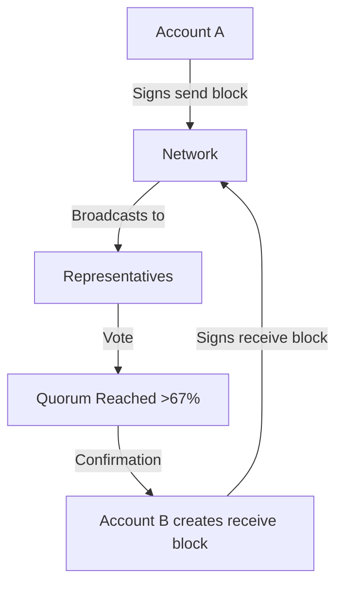

# Protocol Design Overview

This section covers the technical design of the Kakitu protocol in depth. It is intended for developers, researchers, and node operators who want to understand exactly how Kakitu works at the protocol level.

---

## Design Principles

Kakitu is built around three core principles:

1. **Fee-free** — All transfer of value is free. Spam prevention uses computational Proof-of-Work, not fees.
2. **Instant finality** — Transactions confirm in under one second under normal network conditions.
3. **Minimal energy use** — No mining. Consensus uses votes, not computation.

These properties emerge from the combination of the Block Lattice data structure and Open Representative Voting (ORV) consensus.

---

## High-Level Architecture

### Block Lattice

Every account maintains its own **account chain** — a sequential list of state blocks. The account chain records the full history of state changes for that account.

Transfers between accounts are **asynchronous**:
- The sender creates and broadcasts a send block
- The receiver, at any later time, creates and broadcasts a receive block referencing the send

This asynchrony means the receiver does not need to be online when the sender sends.

### Open Representative Voting (ORV)

Consensus is delegated. Account holders assign their balance weight to a **representative**. Representatives vote on blocks. The network tracks cumulative vote weight and confirms a block when enough weight has voted in its favor.

---

## Protocol Layers

| Layer | Components |
|---|---|
| Data | Block Lattice, account chains, ledger (LMDB) |
| Consensus | Open Representative Voting, vote gossip, confirmation height |
| Network | Live network (block/vote propagation), Bootstrap network (ledger sync) |
| Security | Ed25519 signatures, Blake2b hashing, PoW spam prevention |

---

## Section Index

| Page | Content |
|---|---|
| [Block Lattice](block-lattice.md) | How the Block Lattice data structure works |
| [Blocks](blocks.md) | State block format and field definitions |
| [Work](work.md) | Proof-of-Work algorithm and difficulty |
| [Networking](networking.md) | Live network, bootstrap, and peer discovery |
| [ORV Consensus](orv-consensus.md) | Open Representative Voting in detail |
| [Representatives](representatives.md) | Role, selection, and principal representatives |
| [Signing & Hashing](signing-hashing.md) | Ed25519 signatures and Blake2b hashing |
| [Attack Mitigations](attack-mitigations.md) | How the protocol defends against attacks |
| [Original Whitepaper](whitepaper.md) | The original Nano whitepaper (adapted for Kakitu) |
