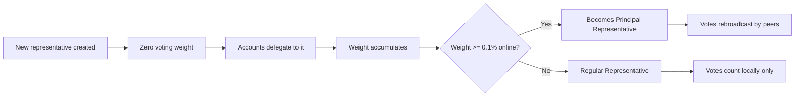

# Representatives

Representatives are Kakitu accounts that vote on the validity of transactions on behalf of accounts that have delegated their balance weight to them.

---

## What Representatives Do

1. **Receive blocks** — monitor the network for new blocks that need confirmation
2. **Vote** — sign and broadcast vote messages expressing support for valid blocks
3. **Propagate votes** — pass votes from other representatives to the rest of the network (PRs only)

Representatives do not:
- Hold other users' funds
- Have any ability to block or censor transactions
- Earn rewards or fees

---

## Delegating to a Representative

Every account can delegate its balance weight to any representative. Delegation:
- Is free (costs no KSHS, just a change block with PoW)
- Can be changed at any time
- Does not move your funds

```bash
# Change representative via RPC
curl -s -d '{
  "action": "account_representative_set",
  "wallet": "WALLET_ID",
  "account": "kshs_YOUR_ACCOUNT",
  "representative": "kshs_REPRESENTATIVE_ADDRESS"
}' http://localhost:7076
```

When an account is first opened, the representative defaults to the account address of the first block's `representative` field.

---

## How to Become a Representative

Any node operator can become a representative. The steps are:

1. Run a Kakitu node with `enable_voting = true`
2. Set the `representative` field in your node's config to your `kshs_` address
3. Ensure that address's private key is available in your node's wallet
4. Ask others to delegate their balance weight to your address
5. Keep the node online with high uptime

A new representative starts with zero weight and grows as more accounts delegate to it.

---

## Principal Representatives

A **Principal Representative (PR)** holds at least **0.1% of online voting weight**.

PR votes are rebroadcast by every node that receives them, giving PRs network-wide reach. Non-PR votes count toward quorum only for the nodes that directly receive them.

Becoming a PR requires accumulating significant delegated weight. The network typically has 10–30 active PRs.

To check current PRs:

```bash
curl -s -d '{
  "action": "representatives",
  "count": "100",
  "sorting": "true"
}' http://localhost:7076
```

---

## Choosing a Good Representative

When choosing who to delegate to, consider:

| Factor | Why it matters |
|---|---|
| **Uptime** | Representatives that go offline reduce network quorum, slowing confirmations |
| **Infrastructure** | Good hardware and connectivity = faster vote propagation |
| **Decentralization** | Delegating to smaller reps improves network resilience |
| **Transparency** | Operators who publish their uptime and configuration are more accountable |
| **Not self-custodied by an exchange** | Exchange reps create centralization risk |

You can view representative stats at [explorer.kakitu.org/representatives](https://explorer.kakitu.org/representatives).

---

## Representative Lifecycle



---

## Offline Representatives

The network tracks **online voting weight** using a rolling window of recent vote activity. Representatives that have not sent a vote recently are excluded from the online weight calculation.

If a large representative goes offline:
- Online voting weight decreases
- The quorum delta (`0.67 × online_weight`) decreases proportionally
- Network can still confirm transactions, just with a reduced set of voters

This is by design — the network remains functional even when some representatives are offline.
