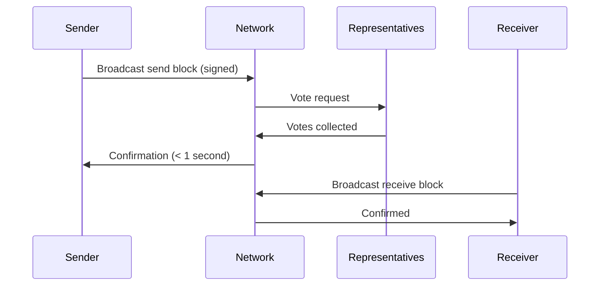

# What is Kakitu?

Kakitu is a feeless, instant digital currency designed as Kenya's digital shilling. It is built on the Nano protocol — one of the most efficient consensus mechanisms ever designed — and adapted specifically for Kenya and the East African financial landscape.

The name *Kakitu* means "our small thing" in Kikuyu, a nod to community ownership and grassroots adoption.

---

## The Problem Kakitu Solves

Kenya has one of the world's highest rates of mobile money adoption, driven largely by M-Pesa. But M-Pesa charges fees on every transaction, imposes withdrawal and transfer limits, requires KYC for accounts, and is controlled by a single private corporation.

For the millions of Kenyans who send small amounts daily — paying for groceries, sending money to family, settling market debts — these fees add up. A 5 KES fee on a 50 KES transfer is a 10% tax on the poor.

Kakitu eliminates this entirely. Every transaction is:

- **Free** — no fees, ever
- **Instant** — confirmed in under a second
- **Open** — no account required beyond a cryptographic key pair
- **Censorship-resistant** — no single party controls the network

---

## How Kakitu Works

Kakitu uses a **Block Lattice** — a data structure where every account has its own blockchain. Instead of every transaction competing to be included in a shared global block (like Bitcoin or Ethereum), each account independently manages its own chain of transactions.

This means:

- Transactions don't compete with each other
- No block size limits that cause congestion
- No fees required to prioritize your transaction
- Network throughput scales horizontally

Consensus is achieved through **Open Representative Voting (ORV)**. Account holders delegate their balance weight to a representative of their choice. When a transaction is submitted, representatives vote on its validity. Once votes representing more than a quorum threshold (67% of online voting weight) are collected, the transaction is confirmed.



---

## Kakitu vs. Other Systems

| Property | Kakitu (KSHS) | M-Pesa | Bitcoin | Ethereum |
|---|---|---|---|---|
| Fees | 0 | ~1–5% | Variable (high) | Variable (high) |
| Confirmation time | < 1 second | Instant (centralized) | ~10–60 minutes | ~15 seconds–minutes |
| Decentralized | Yes | No | Yes | Yes |
| Open source | Yes | No | Yes | Yes |
| Requires internet | Yes | Yes (or USSD) | Yes | Yes |
| Requires identity (KYC) | No | Yes | No | No |
| Energy use | Minimal | Low (centralized) | Very high | Moderate |
| Programmable | Planned | No | Limited | Yes |

---

## The KSHS Currency

The native currency of Kakitu is **KSHS** (Kenya Shilling digital equivalent). All addresses start with the prefix `kshs_`.

An example Kakitu address:

```
kshs_3t6k35gi95xu6tergt6p69ck76ogmitsa8mnijtpxm9fkcm736xtoncuohr3
```

The smallest unit of KSHS is **raw**. The conversion is:

```
1 KSHS = 10^30 raw
```

All RPC operations use raw units. Floating-point arithmetic should be avoided; use arbitrary-precision integer libraries.

---

## Who Should Use This Documentation

This documentation targets:

- **Node operators** — running infrastructure that supports the Kakitu network
- **Developers** — building wallets, exchanges, or payment integrations on Kakitu
- **Protocol researchers** — understanding the technical design of the Block Lattice and ORV
- **Community members** — learning how to contribute, delegate voting weight, and run representatives

---

## Next Steps

- [Run a node](../running-a-node/overview.md) to support the network
- [Read the integration guide](../integration-guides/the-basics.md) to build on Kakitu
- [Understand the protocol](../protocol-design/overview.md) at the deepest level
- [See the RPC reference](../commands/rpc-protocol.md) for API commands
